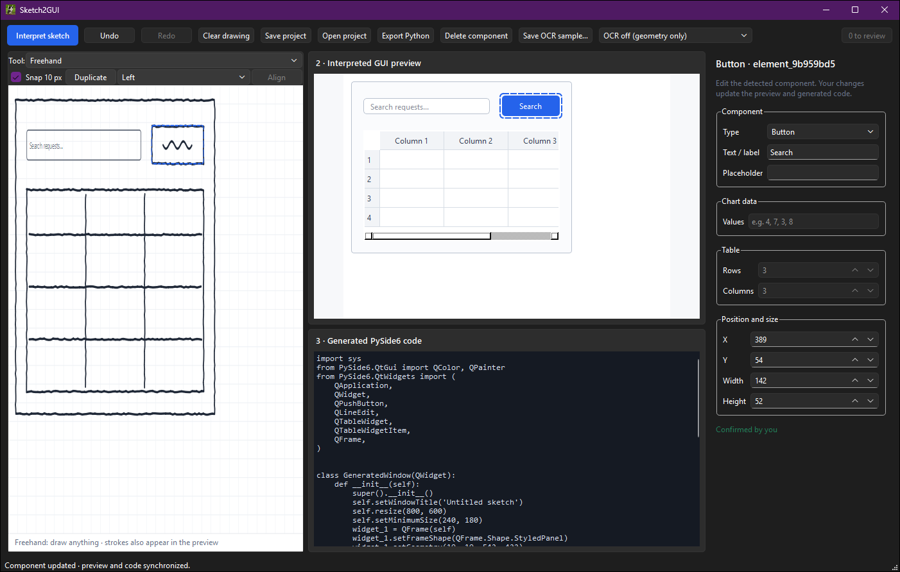

# Sketch2GUI

Draw a rough interface with the mouse and get an editable layout and a runnable PySide6 app out of it.

Built with Python and PySide6 (Qt), with optional local OCR through PaddleOCR. The sketch canvas, the live preview, saved projects and the code generator all share one design model, so an edit in one place shows up everywhere straight away.



The sketch was interpreted with OCR off. The search box was drawn with the Text field tool, and the button's label was typed in the properties panel.

## What it does

- Turns freehand strokes into components: panels, buttons, text fields, tables, lines and ellipses. Guesses it isn't sure about are marked for review rather than shown as certain.
- Optional OCR reads short English text written inside a shape (for example "Search" or "Email") and uses it to decide what the shape is.
- Component tools for drawing a button, text field, label, table, chart and more directly, when you already know what you want.
- Edit anything afterwards: change its type, label, placeholder, table cells or chart values, and move, resize, duplicate, align or multi-select it. Undo and redo work across edits.
- Exports a standalone PySide6 window with real widgets, the table data, line charts and any freehand strokes kept as drawings.
- Saves and opens projects as JSON.

## How recognition works

A first pass uses plain geometry rules: whether a stroke is closed, how straight it is, its size and proportions, and what it contains. A box with ruled lines inside becomes a table, a wide empty box a text field, a box with writing inside a button. A rectangle can still mean several things, so the component tools and the properties panel are part of the normal workflow rather than a fallback.

OCR helps with the text inside shapes; it doesn't understand a whole interface. [docs/ocr-evaluation.md](docs/ocr-evaluation.md) compares the OCR setups that were tried and explains why PaddleOCR with binary preprocessing was chosen.

## Running it

You need Windows and 64-bit Python 3.13. Double-click `run.bat`: it creates `.venv`, installs the app and the PaddleOCR dependencies and starts it. The first setup can take a few minutes because the OCR runtime is large, and the OCR model downloads the first time you use it.

Or from PowerShell:

```powershell
py -3.13 -m venv .venv
.\.venv\Scripts\python.exe -m pip install -r requirements.txt -r requirements-ocr-paddle.txt
.\.venv\Scripts\python.exe -m sketch2gui
```

Pick **PaddleOCR · English** or **OCR off (geometry only)** next to **Interpret sketch**. An experimental TrOCR adapter is available for development with `requirements-ocr-trocr.txt`; it isn't part of the Windows build.

## Tests

```powershell
.\.venv\Scripts\python.exe -m unittest discover -s tests -v
```

The tests cover the geometry rules, the design model, code generation, OCR parsing and preprocessing, and the main window's editing workflows. The PaddleOCR adapter is tested against a stand-in model, so the tests need no OCR download.

## Building the Windows app

```powershell
powershell -ExecutionPolicy Bypass -File .\release_windows.ps1
```

This builds `dist\Sketch2GUI` with PyInstaller and packages it as a ZIP with a SHA-256 checksum. Keep the folder together with `Sketch2GUI.exe`; the OCR model isn't bundled and downloads on first use. GitHub Actions runs the tests and builds the app on Windows with `build_windows.bat`.

## Project layout

| Path | Contents |
| --- | --- |
| `sketch2gui/` | The app: design model, geometry recognition, code generator, OCR adapters and UI |
| `tests/` | Unit and GUI tests |
| `tools/ocr/` | Scripts for preparing OCR samples and comparing engines |
| `docs/` | OCR evaluation notes |
| `run.bat`, `build_windows.bat`, `release_windows.ps1` | Run from source, build, and package a release |

## Limitations

- Recognition is rule-based, so expect to correct some components; ambiguous boxes are flagged for review.
- OCR results are suggestions. Its confidence scores come from the model and aren't calibrated probabilities.
- Exported layouts use fixed positions and don't resize their contents with the window.

## License

MIT. See [LICENSE](LICENSE).
